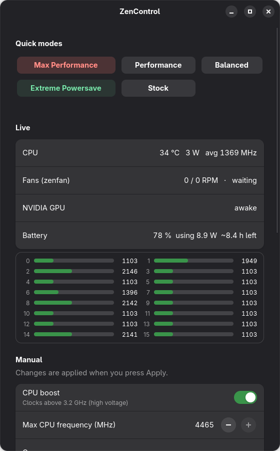

# ZenControl

A small GTK4 / libadwaita app for controlling CPU and GPU power on the **ASUS Zenbook UX535QE** under Linux. Pick a power mode with one click, or set each limit yourself, while watching temperatures, clocks, power draw and battery life update live.

<p align="center">
  
  
</p>

## Features

- **Quick modes**: Max Performance, Performance, Balanced, Extreme Powersave, and Stock (restores the values saved the first time you apply a change)
- **Live monitoring**: CPU temperature and package power, per-core clocks, fan RPM, NVIDIA GPU state, battery draw and estimated time left
- **CPU controls**: boost on/off, max frequency, governor, energy performance preference (EPP), ASUS firmware platform profile
- **NVIDIA GPU controls**: Dynamic Boost (`nvidia-powerd`), power limit, max graphics clock
- **Advanced**: SMT on/off, battery charge limit (60–100 %)
- **GPU wake tracker**: lists the apps keeping the dGPU awake, with a button to quit them so the GPU can sleep

## Safety

- The GUI runs as your normal user. Only a small helper runs as root, through `pkexec`, and it accepts a fixed set of settings, each range-checked against the limits the hardware reports.
- It never touches fan curves, voltages, SMU/MSR registers, drivers or boot configuration.
- Fan state is saved before changing the ASUS profile and restored right after.
- Nothing is persistent: a reboot brings back the default settings.
- Monitoring never wakes the NVIDIA GPU. `nvidia-smi` is only called while the GPU is already awake.

## Requirements

- Linux with `amd-pstate` (`amd-pstate-epp` for EPP) and the `asus-wmi` platform profile
- Python 3, GTK 4, libadwaita 1.5+, PyGObject
- polkit (`pkexec`)
- NVIDIA proprietary driver (`nvidia-smi`, optional `nvidia-powerd`) for the GPU controls

On Fedora:

```sh
sudo dnf install python3-gobject gtk4 libadwaita polkit
```

## Install

```sh
git clone https://github.com/Aliyov/ZenControl.git
cd ZenControl
./install.sh
```

This installs the helper to `/usr/local/libexec/zencontrol-helper`, a polkit policy, and a desktop entry. Open **ZenControl** from the app menu, or run:

```sh
python3 app/zencontrol.py
```

To uninstall:

```sh
./install.sh uninstall
```

## Modes

| Mode | CPU | GPU | Firmware profile |
|---|---|---|---|
| Max Performance | boost on, up to 4465 MHz | stock limit, Dynamic Boost on | performance |
| Performance | boost off, 3200 MHz | 30 W, Dynamic Boost off | performance |
| Balanced | 2800 MHz, `balance_performance` | 25 W | balanced |
| Extreme Powersave | 1800 MHz, `power` EPP | left alone so it can sleep | quiet |
| Stock | values saved on first run | default | as saved |

Modes are defined in [`data/profiles.json`](data/profiles.json) and can be edited.

## Project layout

```
app/zencontrol.py         GTK app
app/monitor.py            read-only sensor access
helper/zencontrol-helper  root helper (via pkexec)
data/                     polkit policy and mode presets
diag/                     stress test and sensor logger for stability testing
install.sh                installer
```

## Diagnostics

`diag/` has tools for stability testing:

```sh
gcc -O2 -mavx2 -mfma -pthread diag/stress.c -o diag/stress
./diag/stress fma 60 16        # AVX2 FMA load with result checking, 60 s, 16 threads
./diag/stress mem 60 16 256    # memory write/verify, 256 MB per thread
python3 diag/logger.py run.csv 95   # 1 Hz sensor log, kills the load if Tctl reaches 95 °C
```

## Disclaimer

Changing power limits is at your own risk. ZenControl is not affiliated with ASUS or NVIDIA.
