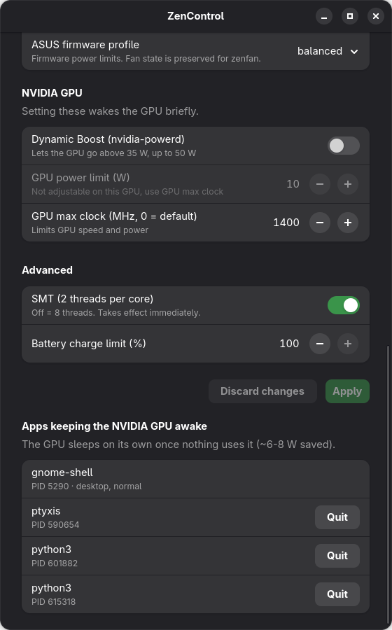

# ZenControl

**One app to choose how fast, how cool and how long-lasting your laptop is.**

ZenControl is a Linux app for the **ASUS Zenbook UX535QE**. With one click you can make the laptop fast for games, quiet and cool for school work, or super thrifty when the battery is low. It also shows you what is happening inside the laptop, live, while you use it.

<p align="center">
  
  
</p>

## Contents

- [The big idea](#the-big-idea)
- [A few words you will see](#a-few-words-you-will-see)
- [Quick modes](#quick-modes)
- [The Live section](#the-live-section)
- [Manual controls](#manual-controls)
- [NVIDIA GPU controls](#nvidia-gpu-controls)
- [Advanced controls](#advanced-controls)
- [Apps keeping the NVIDIA GPU awake](#apps-keeping-the-nvidia-gpu-awake)
- [Is it safe?](#is-it-safe)
- [Installing](#installing)
- [Test results](#test-results)
- [For tinkerers](#for-tinkerers)

---

## The big idea

Your laptop has two "brains":

- The **CPU** is the main brain. It thinks about everything: opening apps, loading web pages, running games.
- The **GPU** is the artist. It draws the pictures you see in games and videos. This laptop has a small built-in artist (inside the AMD chip) for easy jobs, and a big strong artist, the **NVIDIA GeForce RTX 3050 Ti**, for heavy jobs like games.

Both brains can work **fast** or **slow**:

- Working fast is great for games, but it uses a lot of energy. The battery empties quicker, the laptop gets hot, and the fans get loud.
- Working slowly saves energy. The battery lasts longer and the laptop stays cool and quiet, but heavy things run slower.

It's like running versus walking. Running gets you there sooner, but you get tired and sweaty. Walking is slower, but you can keep going for a long time.

**ZenControl lets you choose: run, jog, walk, or stroll.**

---

## A few words you will see

| Word | What it means |
|---|---|
| **MHz** (megahertz) | How many tiny steps a brain takes every second. 1000 MHz is a billion steps per second! More MHz = faster. |
| **GHz** (gigahertz) | 1 GHz = 1000 MHz. So 3.2 GHz = 3200 MHz. |
| **W** (watts) | How much energy something eats right now. More watts = battery empties faster and more heat. |
| **°C** | Temperature. Laptop brains are happy below about 80 °C. Above 90 °C is very hot. |
| **RPM** | How fast the fans spin (turns per minute). Higher = more cooling, but louder. |
| **Core** | The CPU is really 8 small brains working together. Each one is a "core". |
| **Thread** | Each core can juggle 2 jobs at once, so 8 cores give 16 "threads". |
| **AC** | Plugged into the wall charger. |

---

## Quick modes

These are the big buttons at the top. Press one and every setting changes at once. You don't need to touch anything else.

The first time you press a button, your computer asks for your password. This is normal: changing how the hardware works needs permission, like asking a parent before changing the TV settings. It remembers the password for a few minutes.

### 🔴 Max Performance: *sprinting*

Everything goes as fast as it can.

- The CPU can **boost** up to 4.465 GHz, its top speed.
- The NVIDIA GPU can use up to **50 W** when plugged in (using a feature called *Dynamic Boost*, explained below).
- The ASUS firmware is set to "performance", so the laptop allows itself more power.

**Good for:** big games, video editing, anything heavy, **while plugged in**.

**Watch out:** this uses the most energy and makes the most heat. On the developer's laptop, sudden restarts happened with these settings under very heavy load. That's why the button is red and the app asks "Are you sure?" before turning it on.

### ⚪ Performance: *running*

Fast, but without the extra sprint.

- CPU **boost is off**, so it stays at up to 3.2 GHz. That's still fast, but it needs much less power and heat than boosting.
- The GPU runs at full speed, but **without Dynamic Boost**, so it stays at its normal limit: 35 W when plugged in, 30 W on battery.
- ASUS firmware profile: "performance".

**Good for:** most games and heavy work, with less heat and more stability than Max Performance. **A great everyday "fast" mode.**

### ⚪ Balanced: *jogging*

A middle path between speed and saving energy.

- The CPU can go up to **2.8 GHz**. It uses a smart setting that speeds up when you need it and slows down when you don't.
- The NVIDIA GPU is **capped at 1400 MHz**, which keeps it at about 28 W at most.
- ASUS firmware profile: "balanced".

**Good for:** school work, browsing, videos, light games, on battery or plugged in.

### 🟢 Extreme Powersave: *strolling*

Everything goes slow and gentle, so the battery lasts as long as possible.

- The CPU is limited to **1.8 GHz** and is told to save energy whenever it can.
- The NVIDIA GPU is **capped at 900 MHz** (about 16 W at most).
- ASUS firmware profile: "quiet", so the laptop stays cool and silent.

**Good for:** reading, writing, watching videos, when the battery is low, or when you're far from a charger.

### ⚪ Stock: *back to how it was*

The very first time you change anything, ZenControl takes a "photo" of all your settings as they were. Pressing **Stock** puts everything back the way that photo shows.

On the UX535QE, the factory settings are the same as Max Performance.

> 💡 **Tip:** Restarting the laptop also puts everything back to the factory settings. ZenControl never makes permanent changes.

---

## The Live section

This part is like a car dashboard. It updates every 2 seconds so you can see what's going on inside.

| Row | What it tells you |
|---|---|
| **CPU** | How hot the main brain is (°C), how much energy it eats right now (W), and its average speed (MHz). |
| **Fans (zenfan)** | How fast the two fans spin (RPM), and what the separate fan program *zenfan* is doing. ZenControl never controls the fans itself; it just shows you. If zenfan isn't installed, it says "not running". |
| **NVIDIA GPU** | Whether the big artist is **asleep** (uses 0 W, great for battery) or **awake**. When awake, it also shows its temperature, how much energy it uses compared to its limit, and its speed. |
| **Battery** | How full the battery is (%). When plugged in, it shows how fast it's charging. On battery, it shows how fast it's emptying and roughly how many hours are left. |

Below that are **16 little bars**, one for each CPU thread. A long bar means that thread is running fast right now; a short bar means it's resting. "off" means that thread is switched off (see SMT below).

---

## Manual controls

Want to choose things yourself instead of using a quick mode? Change anything here, then press **Apply**. Nothing changes until you press Apply. Changed your mind? Press **Discard changes** and everything goes back to how it really is right now.

| Control | What it does |
|---|---|
| **CPU boost** | Lets the CPU go above 3.2 GHz for short bursts, up to 4.465 GHz. It's like a sprint: very fast, but it needs a lot more power and makes a lot more heat. Turning it off is one of the best ways to keep the laptop cool. |
| **Max CPU frequency** | The CPU's speed limit, in MHz. Like a speed limit sign on a road: the CPU can go slower, but never faster. If boost is off, the CPU can't go above 3200 MHz anyway, and the app will remind you. |
| **Governor** | The CPU's "driving style". **performance** = always ready to go fast. **powersave** = smart, speeds up only when there's work to do. Don't worry about the name: "powersave" can still be fast! |
| **Energy preference** | Only works with the *powersave* governor. It tells the CPU how eager to be, from **performance** (very eager) through **balance_performance** and **balance_power** to **power** (very lazy, saves the most energy). |
| **ASUS firmware profile** | A setting built into the laptop by ASUS. **performance** lets the whole laptop use more power, **balanced** is in the middle, and **quiet** keeps it cool and silent. Your fan settings stay exactly as they were when you change this. |

---

## NVIDIA GPU controls

These control the big artist. Changing them wakes the GPU up for a moment, and then it can go back to sleep.

| Control | What it does |
|---|---|
| **Dynamic Boost** | When the CPU isn't busy, this lets the GPU borrow some of the CPU's energy, so the GPU can go from 35 W up to 50 W. That means smoother games. It only works **when plugged in**: the laptop turns it off on battery by itself. |
| **GPU power limit** | On some laptops this sets the most watts the GPU may use. On the UX535QE, NVIDIA doesn't allow changing it, so it's greyed out. Use **GPU max clock** instead. |
| **GPU max clock** | The GPU's speed limit in MHz. A lower number means less energy and less heat. **0** means "no limit". For example, 1400 MHz keeps it around 28 W and 900 MHz around 16 W. |

---

## Advanced controls

| Control | What it does |
|---|---|
| **SMT (2 threads per core)** | Normally each of the 8 CPU cores juggles 2 jobs at once, giving 16 threads. Turning SMT **off** makes each core do just 1 job, so 8 threads. That can save a bit of energy and heat, but busy programs get slower. Most people should leave it **on**. |
| **Battery charge limit** | Stops charging when the battery reaches this level. Batteries are like balloons: always filling them to the very top wears them out faster. If your laptop is plugged in most of the time, setting **80 %** helps the battery stay healthy for more years. Set **100 %** before a trip when you need every bit of battery. |

---

## Apps keeping the NVIDIA GPU awake

The big NVIDIA artist uses about **6–8 W just by being awake**, even doing nothing. When no app needs it, it falls asleep on its own and that energy is saved, which can mean much more battery time.

This list shows which apps are keeping it awake:

- **gnome-shell** or **Xwayland** are part of your desktop. That's normal, leave them alone.
- Any other app has a **Quit** button. Pressing it politely asks the app to close (like clicking its X button), so the GPU can sleep. Save your work in that app first!

If the list says **"GPU is asleep"**, everything is already perfect.

---

## Is it safe?

ZenControl was built to be careful:

- **Nothing is permanent.** Restart the laptop and everything is back to factory settings.
- **It only changes safe settings.** It never touches fan speeds, voltages, drivers, or how the laptop starts up.
- **It checks every number.** If you ask for something the hardware can't do (like a speed that's too high), it says no and tells you why.
- **It asks permission.** Only a tiny helper program gets admin rights, and only after you type your password.
- **Watching doesn't wake the GPU.** The Live section never wakes the NVIDIA GPU just to read its numbers.

---

## Installing

### What you need

- Fedora Linux (or another Linux with the same parts) on an ASUS Zenbook UX535QE
- The NVIDIA driver, for the GPU controls

Install the building blocks (on Fedora):

```sh
sudo dnf install python3-gobject gtk4 libadwaita polkit
```

### Install ZenControl

```sh
git clone https://github.com/Aliyov/ZenControl.git
cd ZenControl
./install.sh
```

It asks for your password once. Then open **ZenControl** from your app menu, or run:

```sh
python3 app/zencontrol.py
```

### Remove ZenControl

```sh
./install.sh uninstall
```

---

## Test results

Every mode was tested on a real UX535QE, plugged in, with the GPU and the CPU working as hard as they can (one at a time):

| Mode | GPU speed | GPU energy | CPU speed (all cores busy) | CPU temperature |
|---|---|---|---|---|
| Max Performance | 1770 MHz | 40 W | up to 4424 MHz on one core | — |
| Performance | 1770 MHz | 35 W | 3169 MHz | 78 °C |
| Balanced | 1395 MHz | 28 W | 2795 MHz | 69 °C |
| Extreme Powersave | 900 MHz | 16 W | 1777 MHz | 52 °C |

See how going from Performance to Extreme Powersave cuts the GPU's energy by more than half, and the CPU runs 26 °C cooler?

---

## For tinkerers

### Change the modes

The quick modes live in [`data/profiles.json`](data/profiles.json). You can edit the numbers or add your own mode; it shows up as a new button.

### Project layout

```
app/zencontrol.py         the app window
app/monitor.py            reads the sensors (never changes anything)
helper/zencontrol-helper  the small admin helper that applies settings
data/                     permission rules and the quick modes
diag/                     stress test and sensor logger for stability testing
install.sh                installer
```

### Technical requirements

- `amd-pstate` CPU driver (`amd-pstate-epp` for energy preference) and the `asus-wmi` platform profile
- Python 3, GTK 4, libadwaita 1.5+, PyGObject, polkit (`pkexec`)
- NVIDIA proprietary driver (`nvidia-smi`, `nvidia-powerd` for Dynamic Boost)

### Stability testing

`diag/` has tools to check that the laptop stays stable:

```sh
gcc -O2 -mavx2 -mfma -pthread diag/stress.c -o diag/stress
./diag/stress fma 60 16        # heavy CPU math for 60 s on 16 threads, checks every answer
./diag/stress mem 60 16 256    # writes and checks 256 MB of memory per thread
python3 diag/logger.py run.csv 95   # logs sensors every second, stops the test if the CPU reaches 95 °C
```

---

## Disclaimer

Changing power settings is at your own risk. ZenControl is not made by or connected to ASUS or NVIDIA.
