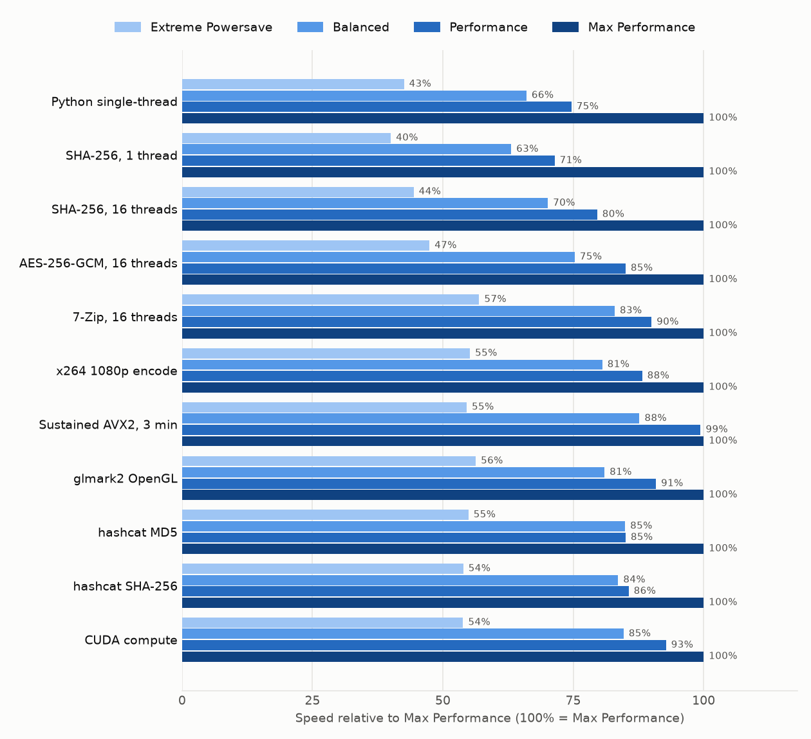
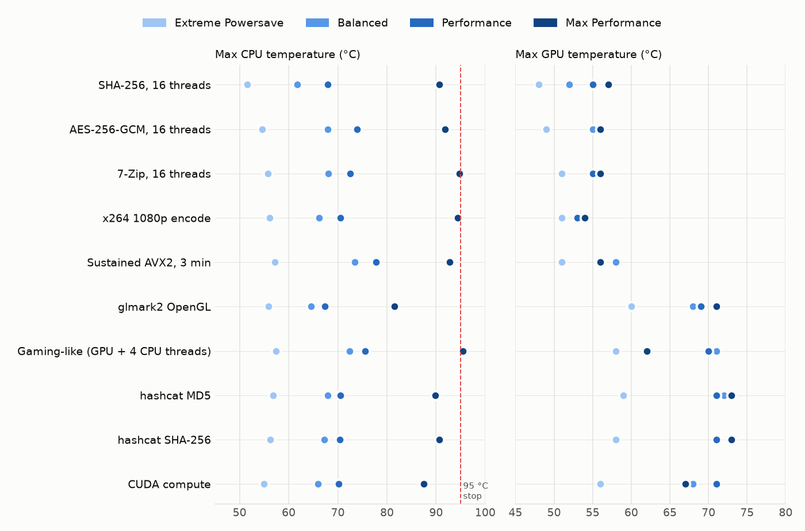
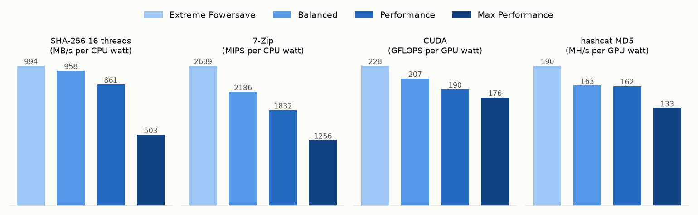

# ZenControl mode benchmark (AC power)

ASUS Zenbook UX535QE · AMD Ryzen 8 cores / 16 threads · NVIDIA GeForce RTX 3050 Ti Laptop GPU · Fedora 44 · NVIDIA driver 615.78 · tested 2026-11-21 on AC power

This report measures how much each ZenControl mode changes real-world speed, temperature, power and fan noise. Every mode ran the same 15 tests, most lasting 1–3 minutes, so the numbers reflect sustained behavior instead of the first few seconds of boost.

## Summary

| | Extreme Powersave | Balanced | Performance | Max Performance |
|---|---|---|---|---|
| **CPU speed, single-thread** | 40–43 % | 63–66 % | 71–75 % | 100 % |
| **CPU speed, multi-thread** | 44–57 % | 70–83 % | 80–90 % | 100 % |
| **CPU speed, sustained 3 min** | 55 % | 88 % | **99 %** | 100 % |
| **GPU speed** | 54–56 % | 81–85 % | 85–93 % | 100 % |
| **Game-like load (GPU + CPU)** | 4124 | 5934 | 6218 | **stopped at 95 °C after ~5 s** |
| **Max CPU temp, heavy CPU load** | 57 °C | 73 °C | 78 °C | 95 °C |
| **Max GPU temp** | 60 °C | 72 °C | 71 °C | 73 °C |
| **CPU fan, sustained load (avg)** | 2200 RPM | 3100 RPM | 5000 RPM | 5500 RPM |
| **CPU power, 16-thread load (avg)** | 13 W | 21 W | 27 W | 58 W |
| **GPU power, full load (avg)** | 17–19 W | 28–34 W | 33–35 W | 40–49 W |

Percentages are relative to Max Performance (100 %).

### Key findings

1. **Max Performance is not stable under game-like load.** With the GPU busy and only 4 CPU threads loaded, the CPU reached 95.5 °C within about 5 seconds and the safety stop ended the test. An 8-thread variant reached 96.2 °C in 8 seconds. Every other mode handled the same load at 57–76 °C. This is the most likely cause of the sudden restarts seen in this mode.
2. **Performance gives 99 % of Max Performance's sustained CPU throughput.** Over a 3-minute all-core load, Max Performance started at 3735 MHz but throttled to 3027 MHz, below Performance's steady 3169 MHz. It finished only 0.6 % more work, while peaking 15 °C hotter (92.8 °C vs 77.8 °C).
3. **CPU boost mainly helps single-threaded work.** Max Performance is 34–40 % faster than Performance on one thread (Python 9.8 s vs 13.1 s), because only boost allows clocks above 3.2 GHz. That's where Max Performance earns its place.
4. **Balanced and Performance give the same frame rates in heavy games.** In the game-like test, the heaviest scene (terrain) ran at 619 FPS in Balanced and 618 FPS in Performance. Under combined load, the GPU is held at its 35 W limit at about 1400 MHz in both modes. Balanced does this with fans about 1000 RPM slower.
5. **Dynamic Boost adds 8–18 % GPU speed for up to 15 W more.** Only Max Performance enables it. It gave +18 % in hashcat, +10 % in glmark2 and +8 % in CUDA, raising GPU power from 35 W to as much as 50 W, but the extra heat also pushes the CPU to 85–90 °C even when only the GPU is working, because they share cooling.
6. **Lower modes are far more efficient.** Extreme Powersave does twice as much CPU work per watt as Max Performance (994 vs 503 MB/s per watt in SHA-256), while delivering 44–57 % of its speed.
7. **No computation errors in any mode.** Every AVX2 stress run verified its results; all passed with zero errors. The two stopped tests were stopped by the benchmark's own 95 °C safety limit, not by a crash.

### Recommendations

| Use | Mode | Why |
|---|---|---|
| Everyday use, browsing, office | **Balanced** | 70–85 % of max speed at 60–70 °C, quiet fans |
| Gaming | **Balanced** or **Performance** | Same FPS in GPU-heavy scenes; Balanced is quieter, Performance has more CPU headroom for CPU-heavy games |
| Long compiles, renders, encodes | **Performance** | 99 % of Max Performance's sustained throughput, 15 °C cooler |
| Short single-threaded bursts | Max Performance | 34–40 % faster on one thread, but only for CPU-only work |
| On battery, quiet work | **Extreme Powersave** | Below 58 °C everywhere, fans near idle speed, best efficiency |
| Avoid | Max Performance + games | Hits 95 °C within seconds |

---

## Speed relative to Max Performance

The game-like test is left out of this chart because Max Performance didn't finish it.

## Temperatures

## Efficiency (work per watt)

---

## Detailed results

Temperatures are shown as average / max over the test. Power is the average.

### CPU tests

#### Python single-thread (lower is better)

A fixed pure-Python workload: 9 million MD5 hashes and 60 million integer operations, all on one core. This is how an app launch or a single-threaded script feels.

| Mode | Time | vs Max | CPU temp | CPU power | CPU fan max |
|---|---|---|---|---|---|
| Extreme Powersave | 22.97 s | 43 % | 50 / 50 °C | 5.5 W | 2000 RPM |
| Balanced | 14.80 s | 66 % | 56 / 57 °C | 7.6 W | 1900 RPM |
| Performance | 13.09 s | 75 % | 59 / 61 °C | 8.2 W | 2000 RPM |
| Max Performance | 9.77 s | 100 % | 84 / 92 °C | 21.0 W | 5600 RPM |

Even one boosted core pushes the CPU to 92 °C and the fans to full speed in under 10 seconds.

#### OpenSSL SHA-256, 1 thread (30 s)

| Mode | Speed | vs Max | CPU temp | CPU power |
|---|---|---|---|---|
| Extreme Powersave | 863 MB/s | 40 % | 47 / 48 °C | 4.8 W |
| Balanced | 1361 MB/s | 63 % | 51 / 52 °C | 7.4 W |
| Performance | 1541 MB/s | 71 % | 53 / 53 °C | 7.0 W |
| Max Performance | 2157 MB/s | 100 % | 60 / 62 °C | 13.4 W |

#### OpenSSL SHA-256, 16 threads (45 s)

| Mode | Speed | vs Max | CPU clock | CPU temp | CPU power |
|---|---|---|---|---|---|
| Extreme Powersave | 12.9 GB/s | 44 % | 1777 MHz | 50 / 52 °C | 13.0 W |
| Balanced | 20.4 GB/s | 70 % | 2795 MHz | 59 / 62 °C | 21.3 W |
| Performance | 23.2 GB/s | 80 % | 3169 MHz | 65 / 68 °C | 26.9 W |
| Max Performance | 29.1 GB/s | 100 % | 3974 MHz | 86 / 91 °C | 57.9 W |

#### OpenSSL AES-256-GCM, 16 threads (45 s)

| Mode | Speed | vs Max | CPU temp | CPU power | CPU fan avg |
|---|---|---|---|---|---|
| Extreme Powersave | 16.3 GB/s | 47 % | 54 / 55 °C | 14.4 W | 1980 RPM |
| Balanced | 25.9 GB/s | 75 % | 65 / 68 °C | 28.1 W | 2390 RPM |
| Performance | 29.3 GB/s | 85 % | 72 / 74 °C | 34.0 W | 2920 RPM |
| Max Performance | 34.5 GB/s | 100 % | 87 / 92 °C | 55.2 W | 5260 RPM |

#### 7-Zip benchmark, 16 threads (8 passes, 4–7 min)

Compression and decompression; a good proxy for general multi-threaded work such as compiling.

| Mode | Rating | vs Max | Duration | CPU clock | CPU temp | CPU power | CPU fan avg |
|---|---|---|---|---|---|---|---|
| Extreme Powersave | 33,616 MIPS | 57 % | 424 s | 1763 MHz | 55 / 56 °C | 12.5 W | 2110 RPM |
| Balanced | 48,958 MIPS | 83 % | 282 s | 2777 MHz | 67 / 68 °C | 22.4 W | 2710 RPM |
| Performance | 53,128 MIPS | 90 % | 257 s | 3136 MHz | 70 / 73 °C | 29.0 W | 3810 RPM |
| Max Performance | 59,032 MIPS | 100 % | 228 s | 3758 MHz | 84 / **95** °C | 47.0 W | 5490 RPM |

#### ffmpeg x264 1080p encode (3000 frames, preset medium)

| Mode | Encode speed | Time | vs Max | CPU temp | CPU power |
|---|---|---|---|---|---|
| Extreme Powersave | 115.5 FPS | 26.0 s | 55 % | 55 / 56 °C | 14.9 W |
| Balanced | 168.6 FPS | 17.8 s | 81 % | 64 / 66 °C | 25.9 W |
| Performance | 184.6 FPS | 16.3 s | 88 % | 67 / 71 °C | 31.4 W |
| Max Performance | 209.3 FPS | 14.3 s | 100 % | 88 / 94 °C | 60.9 W |

#### Sustained AVX2 load, 16 threads, 3 minutes

The heaviest possible CPU load, run long enough for temperatures to settle. "Work" is the number of verified compute blocks completed.

| Mode | Work done | vs Max | Clock, first 15 s | Clock, last 30 s | CPU temp | CPU power | CPU fan avg | Errors |
|---|---|---|---|---|---|---|---|---|
| Extreme Powersave | 44,576 | 55 % | 1777 MHz | 1777 MHz | 57 / 57 °C | 14.8 W | 2210 RPM | 0 |
| Balanced | 71,639 | 88 % | 2795 MHz | 2795 MHz | 72 / 73 °C | 31.0 W | 3120 RPM | 0 |
| Performance | 81,221 | 99 % | 3169 MHz | 3169 MHz | 76 / 78 °C | 39.7 W | 5030 RPM | 0 |
| Max Performance | 81,704 | 100 % | 3735 MHz | **3027 MHz** | 77 / 93 °C | 41.5 W | 5480 RPM | 0 |

Max Performance throttles by 19 % within the first minutes and ends up slower than Performance. Every other mode holds its clock steady for the full 3 minutes.

### GPU tests

#### glmark2 OpenGL, 1920×1080, off-screen (8 scenes × 15 s)

| Mode | Score | vs Max | Terrain FPS | Jellyfish FPS | Refract FPS | GPU clock | GPU power | GPU temp | CPU temp |
|---|---|---|---|---|---|---|---|---|---|
| Extreme Powersave | 7290 | 56 % | 464 | 4404 | 1201 | 900 MHz | 18.7 W | 55 / 60 °C | 53 / 56 °C |
| Balanced | 10,487 | 81 % | 609 | 6432 | 1676 | 1379 MHz | 27.6 W | 62 / 68 °C | 59 / 65 °C |
| Performance | 11,764 | 91 % | 610 | 6443 | 1690 | 1575 MHz | 32.8 W | 64 / 69 °C | 63 / 67 °C |
| Max Performance | 12,949 | 100 % | 707 | 8003 | 1930 | 1722 MHz | 40.4 W | 65 / 71 °C | 77 / 82 °C |

In the heaviest scenes (terrain, jellyfish, refract), Balanced and Performance are identical because both hit the 35 W GPU limit. Performance only pulls ahead in lighter scenes, where the GPU can clock higher within that limit.

#### Game-like load: glmark2 heavy scenes + 4-thread CPU load (4 scenes × 30 s)

| Mode | Score | Terrain FPS | Jellyfish FPS | Refract FPS | GPU power | GPU temp | CPU temp | CPU fan avg |
|---|---|---|---|---|---|---|---|---|
| Extreme Powersave | 4124 | 464 | 4506 | 1210 | 21.7 W | 56 / 58 °C | 55 / 57 °C | 2070 RPM |
| Balanced | 5934 | 619 | 6605 | 1686 | 33.4 W | 67 / 71 °C | 69 / 72 °C | 2610 RPM |
| Performance | 6218 | 618 | 6596 | 1697 | 34.6 W | 68 / 70 °C | 73 / 76 °C | 3580 RPM |
| Max Performance | stopped | — | — | — | 37.1 W | 60 / 62 °C | 90 / **95.5** °C | 3360 RPM |

Max Performance reached the 95 °C safety limit about 5 seconds into the test. The CPU load here is AVX2 math, which is heavier than a typical game, but it shows how little thermal headroom this mode leaves when CPU and GPU are both busy.

#### hashcat MD5, brute force (90 s)

| Mode | Speed | vs Max | GPU clock | GPU power | GPU temp | CPU temp |
|---|---|---|---|---|---|---|
| Extreme Powersave | 3.58 GH/s | 55 % | 893 MHz | 18.8 W | 57 / 59 °C | 55 / 57 °C |
| Balanced | 5.54 GH/s | 85 % | 1367 MHz | 33.9 W | 67 / 72 °C | 64 / 68 °C |
| Performance | 5.54 GH/s | 85 % | 1370 MHz | 34.1 W | 67 / 71 °C | 66 / 71 °C |
| Max Performance | 6.52 GH/s | 100 % | 1627 MHz | 49.1 W | 70 / 73 °C | 85 / 90 °C |

#### hashcat SHA-256, brute force (90 s)

| Mode | Speed | vs Max | GPU power | GPU temp | CPU temp |
|---|---|---|---|---|---|
| Extreme Powersave | 0.88 GH/s | 54 % | 18.4 W | 57 / 58 °C | 55 / 56 °C |
| Balanced | 1.37 GH/s | 84 % | 32.8 W | 66 / 71 °C | 63 / 67 °C |
| Performance | 1.40 GH/s | 86 % | 34.1 W | 67 / 71 °C | 66 / 70 °C |
| Max Performance | 1.64 GH/s | 100 % | 49.2 W | 70 / 73 °C | 87 / 91 °C |

#### CUDA FP32 compute (90 s)

| Mode | Throughput | vs Max | GPU clock | GPU power | GPU temp | CPU temp |
|---|---|---|---|---|---|---|
| Extreme Powersave | 3789 GFLOPS | 54 % | 900 MHz | 16.6 W | 55 / 56 °C | 54 / 55 °C |
| Balanced | 5953 GFLOPS | 85 % | 1391 MHz | 28.7 W | 64 / 68 °C | 62 / 66 °C |
| Performance | 6526 GFLOPS | 93 % | 1471 MHz | 34.4 W | 67 / 71 °C | 66 / 70 °C |
| Max Performance | 7034 GFLOPS | 100 % | 1623 MHz | 39.9 W | 65 / 67 °C | 85 / 88 °C |

### Idle (25 s, nothing running)

| Mode | CPU power | CPU clock | CPU temp | CPU fan |
|---|---|---|---|---|
| Extreme Powersave | 4.6 W | 1295 MHz | 50 / 52 °C | 2010 RPM |
| Balanced | 6.0 W | 1614 MHz | 52 / 53 °C | 1910 RPM |
| Performance | 5.4 W | 1727 MHz | 52 / 53 °C | 2050 RPM |
| Max Performance | 7.0 W (spikes to 27 W) | 2138 MHz | 54 / 55 °C | 1900 RPM |

At idle all modes are close. Max Performance shows short power spikes from background tasks boosting to full clock.

---

## Method

- **Power:** AC, battery charging. Each mode was applied through the ZenControl helper and verified.
- **Cooldown:** before every test, the script waited until the CPU was at or below 55 °C and the GPU at or below 50 °C (up to 4 minutes), then 5 more seconds.
- **Sensors:** sampled every second: CPU temperature (Tctl), CPU package power, average clock across all 16 threads, NVIDIA GPU temperature, power and clock, and both fan speeds. Raw data: [`ac/sensors.csv`](ac/sensors.csv), [`ac/results.jsonl`](ac/results.jsonl).
- **Safety stop:** all tests are killed if the CPU reaches 95 °C or the GPU 87 °C.
- **Tools:** OpenSSL 3, 7-Zip, ffmpeg (libx264), glmark2, hashcat 7.1.2 (OpenCL), a small CUDA FMA kernel ([`../diag/gpuburn.c`](../diag/gpuburn.c)) and an AVX2 stress test that verifies every result ([`../diag/stress.c`](../diag/stress.c)). The benchmark itself is [`../diag/bench.py`](../diag/bench.py).

### Limitations

- Each test ran once per mode. The steady values inside each run were very consistent (for example, hashcat's first 5 seconds and full 90 seconds differ by under 2 %), but small differences of 1–3 % between modes are within normal variation.
- Room temperature wasn't measured; all modes were tested in one session (18:09–20:19).
- vkmark (Vulkan) was also run but excluded: it stayed at 325–365 FPS in every mode while the GPU used only 11–19 W. Its frame rate was capped by copying frames to the display through the integrated GPU, not by GPU speed.
- The game-like test uses synthetic AVX2 math as the CPU load, which draws more power than a typical game. Real games will run cooler, but the result still shows Max Performance has very little thermal headroom.
- Battery-power results will differ: there the GPU is limited to 30 W and Dynamic Boost is disabled by the BIOS.
